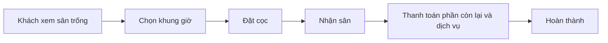

# Tổng quan nghiệp vụ — Cho thuê Sân thể thao

> Mô tả demo này cho ai, giải quyết vấn đề gì. Cập nhật khi phạm vi thay đổi.

---

## 1. Thông tin chung

| Mục | Nội dung |
| :--- | :--- |
| Tên demo | Cho thuê Sân thể thao |
| Mã dự án | `service-cho-thue-san` |
| Ngành / loại khách hàng | Sân pickleball, bóng đá mini, cầu lông, tennis |
| Loại sản phẩm | Web quản lý + trang đặt sân cho khách |
| Ý tưởng gốc | 3.3 · Cho thuê sân thể thao (`ZDOCS/02-KE-HOACH/DANH-SACH-Y-TUONG.md`) |
| Người phụ trách | |
| Trạng thái | Mới tạo từ khuôn mẫu |

## 2. Vấn đề của khách hàng

- Đặt sân qua tin nhắn, dễ trùng lịch
- Giá giờ cao điểm, cuối tuần tính tay
- Khách đặt cố định hằng tuần khó quản lý
- Không biết sân nào, khung giờ nào hiệu quả

## 3. Giải pháp demo thể hiện

- Lịch sân dạng lưới theo khung giờ
- Khách xem sân trống, đặt online
- Bảng giá theo khung giờ, ngày trong tuần
- Đặt cố định theo tuần, đặt cọc, thanh toán
- Bán kèm nước, thuê vợt; báo cáo công suất sân

## 4. Vai trò người dùng

| Vai trò | Mã | Dùng trên | Làm được gì |
| :--- | :--- | :--- | :--- |
| Khách | — | Điện thoại | Xem sân trống, đặt sân |
| Quản trị viên | ADMIN | Desktop | Toàn quyền |
| Chủ sân | MANAGER | Desktop | Sân, bảng giá, báo cáo |
| Nhân viên | STAFF | Tablet | Nhận đặt sân, thu tiền, bán kèm |

## 5. Phân hệ và chức năng

| Area | Chức năng | Màn hình (route FE dự kiến) | Ưu tiên |
| :--- | :--- | :--- | :---: |
| `System` | Đăng nhập, tài khoản, vai trò, cài đặt | Có sẵn | — |
| `Booking` | Sân, loại sân | `/courts` | P1 |
| `Booking` | Lịch sân theo khung giờ | `/schedule` | P1 |
| `Booking` | Đặt sân online | `/dat-san` | P1 |
| `Booking` | Bảng giá giờ cao điểm | `/pricing` | P1 |
| `Booking` | Đặt cố định theo tuần | `/bookings/recurring` | P2 |
| `Booking` | Đặt cọc, thanh toán | `/bookings/[id]` | P1 |
| `Pos` | Bán kèm dịch vụ | `/bookings/[id]` | P2 |
| `Booking` | Báo cáo công suất sân | `/reports` | P2 |

P1 = bắt buộc có để demo · P2 = nên có · P3 = làm thêm nếu còn thời gian.

## 6. Luồng nghiệp vụ chính

## 7. Phạm vi

**Có trong demo:**

- Lịch sân, đặt sân online, bảng giá, thanh toán

**Không làm (nói rõ với khách nếu được hỏi):**

- Cổng thanh toán thật
- Các kết nối bên ngoài khác chỉ giả lập

## 8. Dữ liệu mẫu cần chuẩn bị

| Dữ liệu | Số lượng | Ghi chú |
| :--- | :---: | :--- |
| Cụm sân | 2 |  |
| Sân | 10 | Pickleball, cầu lông, bóng đá mini |
| Khung giá | 4 | Sáng, trưa, chiều tối, cuối tuần |
| Lượt đặt | ~2.000 | 90 ngày và 14 ngày tới |
| Khách hàng | 250 |  |
