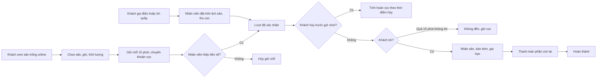
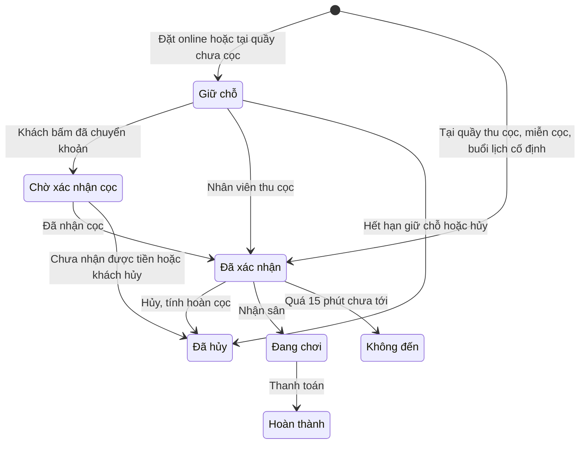
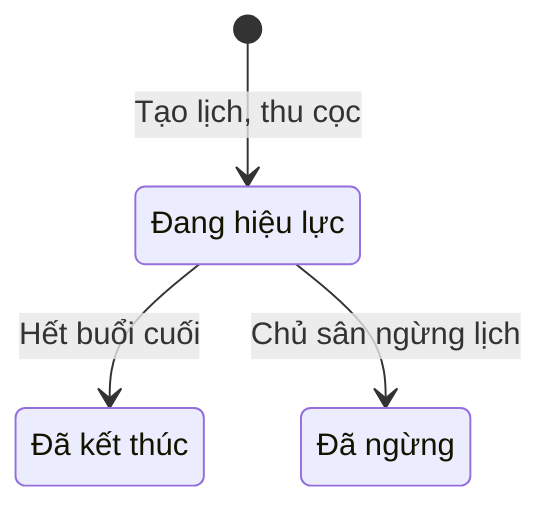

# Đặc tả yêu cầu phần mềm (SRS) — Cho thuê Sân thể thao

| Phiên bản | Ngày | Trạng thái |
| :--- | :--- | :--- |
| 1.0 | 12/10/2026 | Bản nháp để triển khai demo |

> Cách viết, quy ước mã, mức độ chi tiết: `ZDOCS/05-HUONG-DAN/HUONG-DAN-VIET-TAI-LIEU-NGHIEP-VU.md`.
> Phần nền (đăng nhập, tài khoản, vai trò, cài đặt, đặt lại dữ liệu demo): `ZDOCS/03-KIEN-TRUC/USE-CASE-NEN.md`, không viết lại ở đây.

---

## 1. Giới thiệu

### 1.1. Mục đích

Tài liệu mô tả đầy đủ yêu cầu của bản demo Cho thuê Sân thể thao: chức năng, quy tắc chống trùng lịch, cách tính tiền sân theo khung giờ, tiền cọc và hoàn cọc, đặt cố định, dữ liệu, báo cáo, phân quyền và màn hình. Dev dùng để code, tester dùng để viết và chạy test case, sales dùng để biết demo làm được gì.

### 1.2. Phạm vi

**Trong phạm vi:** cụm sân, sân, khóa sân bảo trì; bảng giá theo khung giờ và ngày trong tuần, ngày lễ; lịch sân dạng lưới; đặt sân tại quầy và đặt online có giữ chỗ, cọc chuyển khoản QR; xác nhận cọc; đổi giờ, hủy, hoàn cọc theo chính sách; đặt cố định theo tuần; nhận sân, gia hạn giờ, ghi nhận không đến; bán kèm nước, thuê vợt; thanh toán và in hóa đơn; tổng quan, báo cáo công suất và doanh thu.

**Ngoài phạm vi:** cổng thanh toán thật và tự đối soát tiền về (QR chỉ hiển thị, nhân viên tự xác nhận), tự động chuyển tiền hoàn cọc, SMS và Zalo thật (chỉ ghi nhật ký tin nhắn giả lập), tồn kho nước và số lượng vợt cho thuê, ca làm và đối soát tiền mặt của nhân viên, vé lượt chơi ghép (xé vé), thẻ thành viên trả trước, điều khiển đèn sân, hóa đơn điện tử.

### 1.3. Thuật ngữ

| Thuật ngữ | Giải thích |
| :--- | :--- |
| Cụm sân | Một địa điểm có nhiều sân, có giờ mở cửa riêng, vd "Cụm Bình Thạnh" |
| Loại sân | Môn và quy cách sân: Pickleball, Cầu lông, Bóng đá 5 người, Bóng đá 7 người; quyết định đơn giá |
| Sân | Một sân cụ thể cho thuê, vd "PB3" |
| Khung giá | Khoảng giờ áp một đơn giá: Sáng, Trưa, Chiều tối (ngày thường), Cuối tuần |
| Ngày thường, cuối tuần | Ngày thường là Thứ Hai đến Thứ Sáu; cuối tuần là Thứ Bảy, Chủ nhật và ngày lễ đã khai báo |
| Lượt đặt | Một lần thuê một sân trong một khoảng giờ liên tục |
| Đặt cố định | Thuê lặp lại hằng tuần cùng sân, cùng giờ trong nhiều tuần; mỗi lần là một buổi |
| Tiền sân | Tiền thuê sân của lượt đặt theo bảng giá |
| Tiền cọc | Tiền khách trả trước để giữ sân |
| Giữ chỗ | Lượt đặt đang khóa sân trong lúc chờ khách chuyển cọc |
| Hoàn cọc | Trả lại một phần hoặc toàn bộ tiền cọc khi hủy, theo chính sách |
| Thu nhập cọc | Phần tiền cọc không hoàn, tiệm được giữ lại |
| Nhận sân | Nhân viên ghi nhận khách đã tới và bắt đầu chơi |
| Không đến | Khách không tới và không báo hủy |
| Gia hạn | Khách chơi thêm giờ ngay sau lượt đang chơi |
| Bán kèm | Nước uống, thuê vợt, bóng, áo bib bán trong lượt đặt |
| Còn phải thu | Tổng tiền hóa đơn trừ tiền cọc đã thu |
| Công suất sân | Phần trăm giờ đã bán trên giờ mở cửa |
| Khóa sân | Tạm ngừng cho thuê một sân trong một khoảng thời gian để bảo trì |

### 1.4. Tài liệu liên quan

| Tài liệu | Nội dung |
| :--- | :--- |
| `01-TONG-QUAN-NGHIEP-VU.md` | Tổng quan nghiệp vụ |
| `03-USE-CASE.md` | Đặc tả use case |
| `05-KICH-BAN-KIEM-THU.md` | Test case nghiệm thu |
| `ZDOCS/03-KIEN-TRUC/USE-CASE-NEN.md` | Phần nền dùng chung |

---

## 2. Mô tả tổng quan

### 2.1. Bối cảnh sản phẩm

Chủ sân có 1–3 cụm sân pickleball, cầu lông, bóng đá mini. Mỗi cụm có một quầy, nhân viên dùng tablet để nhận đặt sân qua điện thoại, Zalo, nhóm Facebook, thu cọc, giao sân, bán nước, cho thuê vợt và thu tiền. Chủ sân xem tình hình trên máy tính hoặc điện thoại. Khách tự xem sân trống và đặt qua link gửi trong nhóm Zalo, Facebook. Bản demo có 2 cụm, 10 sân.

### 2.2. Tác nhân

| Mã vai trò | Tên | Thiết bị | Mục tiêu khi dùng hệ thống |
| :--- | :--- | :--- | :--- |
| `ADMIN` | Quản trị viên | Desktop | Cấu hình hệ thống, tài khoản, phân quyền |
| `MANAGER` | Chủ sân | Desktop, điện thoại | Sân, bảng giá, khóa bảo trì, giảm giá lớn, ngừng lịch cố định, xem công suất và doanh thu |
| `STAFF` | Nhân viên | Tablet ngang | Nhận đặt sân không trùng, thu cọc đúng, giao sân, bán kèm, thu tiền, hoàn cọc |
| — | Khách | Điện thoại | Xem sân trống, đặt sân, chuyển cọc, tra cứu và tự hủy, không cần đăng nhập |

Tài khoản demo: `admin`, `quanly` (Chủ sân), `nhanvien` (Nhân viên).

### 2.3. Quy trình nghiệp vụ

### 2.4. Giả định và ràng buộc

- Hai cụm sân dùng chung tài khoản nhân viên; màn hình lọc theo cụm.
- Tiền sân tính cho cả sân theo giờ, không tính theo người chơi; khách tự chia tiền với nhau.
- Đơn giá sân là bội số 10.000 ₫ mỗi giờ; giá bán kèm là bội số 1.000 ₫.
- QR chuyển khoản là ảnh giả lập theo định dạng VietQR. Khách bấm "Tôi đã chuyển khoản", nhân viên đối chiếu app ngân hàng rồi bấm xác nhận; hệ thống không kết nối ngân hàng.
- Hoàn cọc: nhân viên chuyển khoản lại ngoài hệ thống rồi bấm "Đã hoàn"; hệ thống chỉ ghi nhận.
- Không quản lý tồn kho nước, số lượng vợt cho thuê; mặt hàng chỉ có trạng thái còn bán hoặc tạm hết.
- Tin nhắn xác nhận, nhắc giờ chơi, hủy là giả lập: nội dung ghi vào nhật ký tin nhắn của lượt đặt.

---

## 3. Yêu cầu chức năng

### 3.1. Tổng quan

| Mã | Yêu cầu | Ưu tiên | Vai trò | UC |
| :--- | :--- | :---: | :--- | :--- |
| FR-01 | Hệ thống hiển thị trên Tổng quan số lượt đặt hôm nay theo trạng thái, công suất sân hôm nay, doanh thu ghi nhận hôm nay và tổng tiền cọc đang giữ; lọc theo cụm | P1 | MANAGER, STAFF | UC-11 |
| FR-02 | Tổng quan có 3 danh sách việc cần làm: lượt chờ xác nhận cọc, lượt bắt đầu trong 60 phút tới chưa nhận sân, khoản hoàn cọc chờ chuyển; bấm một dòng mở chi tiết lượt đặt | P1 | MANAGER, STAFF | UC-11 |

### 3.2. Sân và bảng giá

| Mã | Yêu cầu | Ưu tiên | Vai trò | UC |
| :--- | :--- | :---: | :--- | :--- |
| FR-03 | Hệ thống cho phép chủ sân thêm, sửa cụm sân với tên, địa chỉ, giờ mở cửa, giờ đóng cửa | P1 | MANAGER | UC-01 |
| FR-04 | Hệ thống cho phép chủ sân thêm, sửa, ngừng hoạt động sân với mã, tên, cụm, loại sân, trong nhà hoặc ngoài trời, ảnh, mô tả, thứ tự hiển thị | P1 | MANAGER | UC-01 |
| FR-05 | Hệ thống cho phép chủ sân khai báo khung giá theo nhóm ngày (ngày thường, cuối tuần) và khung giờ, nhập đơn giá mỗi giờ cho từng loại sân ở từng khung, và tỉ lệ ưu đãi đặt cố định | P1 | MANAGER | UC-02 |
| FR-06 | Hệ thống cho phép chủ sân khai báo ngày lễ áp giá cuối tuần và ngày cụm sân nghỉ | P2 | MANAGER | UC-02 |
| FR-07 | Hệ thống cho phép chủ sân thêm, sửa, ngừng dịch vụ bán kèm (tên, nhóm, đơn vị, giá); nhân viên đánh dấu tạm hết và bán lại | P2 | MANAGER, STAFF | UC-02 |
| FR-08 | Hệ thống cho phép chủ sân khóa một sân trong một khoảng thời gian để bảo trì, có lý do; lượt đặt trùng được liệt kê để chuyển sân hoặc hủy trước khi lưu | P2 | MANAGER | UC-01 |

### 3.3. Lịch sân và đặt sân tại quầy

| Mã | Yêu cầu | Ưu tiên | Vai trò | UC |
| :--- | :--- | :---: | :--- | :--- |
| FR-09 | Màn Lịch sân hiển thị lưới theo ngày: mỗi cột một sân (lọc theo cụm, loại sân), mỗi hàng một mốc 30 phút từ giờ mở tới giờ đóng cửa; ô có màu theo trạng thái lượt đặt, biểu tượng đặt cố định, vùng khóa gạch chéo, vạch giờ hiện tại | P1 | STAFF, MANAGER | UC-03 |
| FR-10 | Nhân viên tạo lượt đặt bằng cách kéo chọn ô trống trên lưới hoặc bấm "Đặt sân": chọn sân, ngày, giờ bắt đầu, thời lượng; tìm khách theo số điện thoại hoặc thêm khách mới; hệ thống hiện tiền sân tách theo khung giá và mức cọc tối thiểu | P1 | STAFF | UC-03 |
| FR-11 | Hệ thống chặn lưu khi lượt đặt trùng lượt khác cùng sân, trùng khoảng khóa, ngoài giờ mở cửa hoặc sai thời lượng, và nêu rõ lý do | P1 | STAFF, Khách | UC-03, UC-04, UC-06 |
| FR-12 | Khi tạo tại quầy, nhân viên chọn một trong ba cách: thu cọc ngay (tiền mặt hoặc chuyển khoản), giữ chỗ chờ cọc có hạn, hoặc miễn cọc khi đủ điều kiện | P1 | STAFF | UC-03 |
| FR-13 | Nhân viên đổi giờ, đổi sân của lượt đặt bằng kéo thả hoặc hộp sửa, chọn bên yêu cầu đổi (khách hoặc sân); hệ thống tính lại tiền sân và hiện chênh lệch | P1 | STAFF | UC-06 |
| FR-14 | Nhân viên và chủ sân tìm lượt đặt theo mã, số điện thoại, tên khách; lọc theo ngày, cụm, trạng thái, trạng thái cọc và hoàn cọc | P2 | STAFF, MANAGER | UC-06 |

### 3.4. Đặt sân online

| Mã | Yêu cầu | Ưu tiên | Vai trò | UC |
| :--- | :--- | :---: | :--- | :--- |
| FR-15 | Trang đặt sân công khai, không cần đăng nhập: khách chọn loại sân, cụm, ngày; hệ thống hiện lưới sân trống theo mốc 30 phút kèm đơn giá từng khung | P1 | Khách | UC-04 |
| FR-16 | Khách chọn sân, giờ bắt đầu, thời lượng, nhập họ tên và số điện thoại; hệ thống hiện tiền sân, tiền cọc, tạo lượt "Giữ chỗ" 15 phút và hiện QR chuyển khoản cọc (giả lập) kèm đồng hồ đếm ngược | P1 | Khách | UC-04 |
| FR-17 | Khách bấm "Tôi đã chuyển khoản", lượt chuyển "Chờ xác nhận cọc"; hết 15 phút chưa bấm thì hệ thống tự hủy giữ chỗ | P1 | Khách | UC-04 |
| FR-18 | Nhân viên đối chiếu tiền về và bấm "Đã nhận cọc", hoặc "Chưa nhận được" kèm lý do để hủy lượt | P1 | STAFF | UC-05 |
| FR-19 | Khách tra cứu lượt đặt bằng mã và số điện thoại, xem trạng thái, tiền cọc, số tiền được hoàn nếu hủy lúc này, và tự hủy | P2 | Khách | UC-07 |
| FR-20 | Hệ thống ghi tin xác nhận, tin nhắc trước giờ chơi 2 giờ, tin hủy và hoàn cọc vào nhật ký tin nhắn của lượt đặt (giả lập SMS/Zalo) | P3 | Hệ thống | UC-05 |

### 3.5. Hủy và hoàn cọc

| Mã | Yêu cầu | Ưu tiên | Vai trò | UC |
| :--- | :--- | :---: | :--- | :--- |
| FR-21 | Nhân viên hủy lượt đặt, chọn bên hủy (khách hoặc sân) và lý do (Khách báo hủy, Thời tiết, Mất điện, Sân bảo trì, Khác); hệ thống tính số tiền hoàn theo chính sách, tạo khoản hoàn cọc và ghi phần giữ lại thành thu nhập cọc | P1 | STAFF | UC-06 |
| FR-22 | Nhân viên đánh dấu khoản hoàn cọc "Đã hoàn" sau khi chuyển tiền lại cho khách, nhập mã giao dịch ngân hàng | P1 | STAFF | UC-06 |

### 3.6. Nhận sân, bán kèm, thanh toán

| Mã | Yêu cầu | Ưu tiên | Vai trò | UC |
| :--- | :--- | :---: | :--- | :--- |
| FR-23 | Nhân viên bấm "Nhận sân" khi khách tới; lượt chuyển "Đang chơi", ghi giờ nhận sân | P1 | STAFF | UC-08 |
| FR-24 | Nhân viên đánh dấu "Không đến" cho lượt quá giờ bắt đầu 15 phút chưa nhận sân; tiền cọc chuyển thành thu nhập cọc, phần giờ còn lại trên sân được giải phóng | P1 | STAFF | UC-08 |
| FR-25 | Nhân viên gia hạn giờ chơi thêm từng 30 phút khi sân còn trống ngay sau; tiền phần thêm tính theo bảng giá | P2 | STAFF | UC-08 |
| FR-26 | Nhân viên thêm dịch vụ bán kèm vào lượt đặt (chọn món, số lượng), sửa hoặc xóa trước khi thanh toán | P2 | STAFF | UC-09 |
| FR-27 | Nhân viên thanh toán: hệ thống hiện tiền sân, tiền bán kèm, giảm giá, tiền cọc đã thu, còn phải thu; thu tiền mặt hoặc chuyển khoản (QR giả lập); tạo hóa đơn và mở bản in khổ 80 mm | P1 | STAFF | UC-09 |
| FR-28 | Nhân viên giảm giá theo phần trăm hoặc số tiền trên tiền sân, chọn lý do, trong hạn mức của vai trò | P2 | STAFF, MANAGER | UC-09 |

### 3.7. Đặt cố định

| Mã | Yêu cầu | Ưu tiên | Vai trò | UC |
| :--- | :--- | :---: | :--- | :--- |
| FR-29 | Nhân viên tạo lịch cố định: khách, sân, các thứ trong tuần, giờ bắt đầu, thời lượng, ngày bắt đầu, số tuần; hệ thống liệt kê từng buổi kèm tiền sân sau ưu đãi, đánh dấu buổi trùng, tính tiền cọc | P2 | STAFF | UC-10 |
| FR-30 | Với buổi trùng, nhân viên chọn bỏ qua buổi đó hoặc chuyển sang sân khác cùng loại còn trống; lưu thì hệ thống tạo các lượt đặt con "Đã xác nhận" | P2 | STAFF | UC-10 |
| FR-31 | Nhân viên hủy một buổi lẻ của lịch cố định; chủ sân ngừng phần còn lại của lịch; hệ thống xử lý cọc theo chính sách | P2 | STAFF, MANAGER | UC-10 |
| FR-32 | Danh sách lịch cố định: khách, sân, lịch tuần, số buổi đã chơi, còn lại, không đến, tiền cọc, trạng thái | P2 | STAFF, MANAGER | UC-10 |

### 3.8. Khách hàng

| Mã | Yêu cầu | Ưu tiên | Vai trò | UC |
| :--- | :--- | :---: | :--- | :--- |
| FR-33 | Hệ thống lưu khách theo số điện thoại; khi nhập số điện thoại ở hộp đặt sân, hiện số lượt đã đặt, số lần không đến trong 60 ngày, trạng thái chặn đặt online | P2 | STAFF | UC-03 |
| FR-34 | Chủ sân xem danh sách khách, lịch sử đặt sân, tổng chi tiêu; chặn hoặc bỏ chặn đặt online | P3 | MANAGER | UC-13 |

### 3.9. Báo cáo

| Mã | Yêu cầu | Ưu tiên | Vai trò | UC |
| :--- | :--- | :---: | :--- | :--- |
| FR-35 | Báo cáo công suất: tỉ lệ giờ đã bán theo sân, loại sân, khung giá; bảng nhiệt giờ trong ngày × thứ trong tuần | P2 | MANAGER | UC-12 |
| FR-36 | Báo cáo doanh thu theo ngày: tiền sân sau giảm giá, bán kèm, thu nhập cọc; so với kỳ liền trước cùng độ dài | P2 | MANAGER | UC-12 |
| FR-37 | Báo cáo hủy và không đến: số lượt, tỉ lệ, cọc đã hoàn, cọc giữ lại; xuất báo cáo đang xem ra file Excel | P3 | MANAGER | UC-12 |

---

## 4. Quy tắc nghiệp vụ

| Mã | Quy tắc | Áp dụng cho |
| :--- | :--- | :--- |
| BR-01 | Giờ mở cửa theo cụm, mặc định 05:00–23:00. Lượt đặt nằm trọn trong giờ mở cửa của một ngày. Giờ bắt đầu theo mốc 30 phút (:00, :30) và không sớm hơn mốc 30 phút hiện tại (lúc 10:20 chọn được từ 10:00). Thời lượng tối thiểu 60 phút, bội số 30 phút, tối đa 240 phút tại quầy và 180 phút khi đặt online. Ngày cụm nghỉ không đặt được | FR-10, FR-11, FR-16 |
| BR-02 | Hai lượt cùng sân không được có khoảng [giờ bắt đầu, giờ kết thúc) giao nhau; chạm mép không tính trùng (15:30–17:00 và 17:00–18:30 hợp lệ). Không có thời gian nghỉ giữa hai lượt. Chỉ xét lượt "Giữ chỗ", "Chờ xác nhận cọc", "Đã xác nhận", "Đang chơi", "Hoàn thành". Không đặt vào khoảng khóa bảo trì | FR-11, FR-13 |
| BR-03 | Ngày thường có 3 khung: Sáng 05:00–09:00, Trưa 09:00–16:00, Chiều tối 16:00–23:00; cuối tuần có 1 khung 05:00–23:00. Các khung trong cùng nhóm ngày liền nhau, không chồng nhau và phủ kín giờ mở cửa. Đơn giá theo loại sân và khung, là bội số 10.000 ₫ mỗi giờ | FR-05, FR-06 |
| BR-04 | Tiền sân = tổng tiền từng đoạn 30 phút của lượt; mỗi đoạn bằng đơn giá giờ của khung chứa đoạn đó chia 2. Vd pickleball ngày thường 15:30–17:00 = 50.000 ₫ (30 phút khung Trưa) + 200.000 ₫ (60 phút khung Chiều tối) = 250.000 ₫. Tiền sân lưu vào lượt lúc tạo; đổi bảng giá sau đó không làm đổi lượt đã tạo | FR-10, FR-16 |
| BR-05 | Đặt online: giờ bắt đầu cách lúc đặt ít nhất 60 phút và trong vòng 14 ngày; một số điện thoại có tối đa 2 lượt online ở trạng thái "Giữ chỗ" hoặc "Chờ xác nhận cọc". Số điện thoại đang bị chặn (BR-27) không đặt online được | FR-15, FR-16 |
| BR-06 | Tiền cọc tối thiểu = 50% tiền sân, làm tròn lên tới bội số 10.000 ₫ (vd 350.000 ₫ → 175.000 ₫ → 180.000 ₫). Đặt online cọc đúng mức tối thiểu. Tại quầy, nhân viên thu từ mức tối thiểu tới 100% tiền sân | FR-12, FR-16 |
| BR-07 | Giữ chỗ online 15 phút tính từ lúc tạo lượt. Hết 15 phút mà khách chưa bấm "Tôi đã chuyển khoản" thì lượt tự chuyển "Đã hủy", lý do "Hết hạn giữ chỗ", sân trống lại. Khách bấm rồi thì lượt chuyển "Chờ xác nhận cọc" và giữ sân tới khi nhân viên xử lý; chờ quá 30 phút thì tô đỏ trên Tổng quan | FR-17, FR-18 |
| BR-08 | Tại quầy, không thu cọc ngay thì lượt vào "Giữ chỗ" với hạn cọc; hạn mặc định và tối đa là 24 giờ kể từ lúc tạo nhưng không muộn hơn 2 giờ trước giờ bắt đầu; quá hạn tự hủy. Miễn cọc (vào thẳng "Đã xác nhận" không cọc) chỉ khi giờ bắt đầu cách hiện tại không quá 60 phút. Lượt bắt đầu sau 60 phút nhưng trong vòng 2 giờ thì phải thu cọc ngay | FR-12 |
| BR-09 | Khách hủy: còn từ 24 giờ trở lên tới giờ bắt đầu thì hoàn 100% tiền cọc; từ 6 giờ tới dưới 24 giờ hoàn 50%, làm tròn xuống tới bội số 1.000 ₫; dưới 6 giờ không hoàn. Sân hủy (thời tiết, mất điện, bảo trì đột xuất) hoàn 100% bất kể thời điểm | FR-19, FR-21 |
| BR-10 | Khách tự hủy online được khi lượt "Giữ chỗ", "Chờ xác nhận cọc" hoặc "Đã xác nhận" và chưa tới giờ bắt đầu; trang hiện trước số tiền được hoàn theo BR-09. Hủy lượt "Giữ chỗ" không phát sinh hoàn. Hủy lượt "Chờ xác nhận cọc" thì nhân viên đối chiếu: tiền đã về thì tạo khoản hoàn 100% | FR-19 |
| BR-11 | Khoản hoàn cọc tạo ở trạng thái "Chờ hoàn"; nhân viên chuyển khoản lại ngoài hệ thống rồi bấm "Đã hoàn" kèm mã giao dịch. Phần cọc không hoàn ghi thành thu nhập cọc của ngày hủy | FR-21, FR-22 |
| BR-12 | Chỉ đổi giờ, đổi sân cho lượt "Giữ chỗ", "Chờ xác nhận cọc", "Đã xác nhận"; kiểm tra lại BR-01, BR-02. Khách yêu cầu đổi: phải còn ít nhất 6 giờ trước giờ bắt đầu cũ, mỗi lượt đổi tối đa 1 lần. Sân chủ động đổi (bảo trì, sắp xếp) không giới hạn số lần. Tiền sân tính lại theo giờ và loại sân mới; tiền cọc giữ nguyên, chênh lệch xử lý khi thanh toán | FR-13 |
| BR-13 | Nhận sân được từ 30 phút trước giờ bắt đầu tới giờ kết thúc. Khách tới trễ vẫn kết thúc đúng giờ đã đặt, tiền sân không giảm | FR-23 |
| BR-14 | "Không đến": nhân viên đánh dấu được khi quá giờ bắt đầu 15 phút chưa nhận sân; phần thời gian còn lại trên sân được giải phóng, toàn bộ tiền cọc thành thu nhập cọc. Lúc 23:59 hằng ngày hệ thống tự chuyển các lượt "Đã xác nhận" chưa nhận sân trong ngày sang "Không đến" | FR-24 |
| BR-15 | Gia hạn từng 30 phút, chỉ khi đoạn ngay sau trên cùng sân còn trống và không quá giờ đóng cửa; tiền phần thêm tính theo BR-04 và cộng vào tiền sân của lượt | FR-25 |
| BR-16 | Tổng tiền hóa đơn = tiền sân + tiền bán kèm − giảm giá. Còn phải thu = tổng tiền − tiền cọc đã thu. Còn phải thu âm thì hệ thống hiện "Trả lại khách" kèm số tiền và ghi nhận khi hoàn tất | FR-27 |
| BR-17 | Giảm giá chỉ áp trên tiền sân, không áp cho bán kèm; giảm phần trăm làm tròn xuống tới bội số 1.000 ₫. Nhân viên giảm tối đa 10% tiền sân, chủ sân tối đa 30% | FR-28 |
| BR-18 | Tiền mặt: tiền khách đưa phải lớn hơn hoặc bằng còn phải thu; tiền thối = tiền khách đưa − còn phải thu. Chuyển khoản: QR có số tiền cần thu, nội dung là mã lượt đặt | FR-12, FR-16, FR-27 |
| BR-19 | Chỉ thanh toán lượt "Đang chơi"; hoàn tất thì lượt chuyển "Hoàn thành". Dịch vụ bán kèm đang tạm hết không chọn được. Khách muốn trả trước toàn bộ thì thu cọc 100% tiền sân | FR-26, FR-27 |
| BR-20 | Đặt cố định: 4–26 tuần, 1–7 buổi mỗi tuần, cùng sân, cùng giờ, cùng thời lượng; ngày bắt đầu trong 14 ngày tới. Tiền sân mỗi buổi tính theo BR-04 rồi trừ ưu đãi cố định (mặc định 10%), phần ưu đãi làm tròn xuống tới bội số 1.000 ₫; buổi rơi vào ngày lễ tính giá cuối tuần | FR-29 |
| BR-21 | Cọc lịch cố định = tiền sân sau ưu đãi của buổi đầu tiên, làm tròn lên tới bội số 10.000 ₫; thu một lần khi tạo lịch và trừ vào thanh toán buổi cuối cùng. Các buổi của lịch cố định vào thẳng "Đã xác nhận", không cọc từng buổi | FR-29, FR-30 |
| BR-22 | Buổi trùng lượt đã có hoặc khoảng khóa: nhân viên chọn bỏ qua buổi đó hoặc chuyển sang sân khác cùng loại còn trống; không lưu được khi còn buổi trùng chưa xử lý | FR-30 |
| BR-23 | Hủy buổi lẻ của lịch cố định: báo trước từ 24 giờ thì buổi chuyển "Đã hủy", không mất phí; dưới 24 giờ hoặc không tới thì buổi ghi "Không đến". Khách không tới 2 buổi liên tiếp thì hệ thống gợi ý chủ sân ngừng lịch. Ngừng lịch: các buổi chưa diễn ra chuyển "Đã hủy"; báo trước từ 7 ngày so với buổi kế tiếp thì hoàn 100% cọc lịch cố định, dưới 7 ngày giữ lại cọc thành thu nhập cọc | FR-31 |
| BR-24 | Khoảng khóa bảo trì không được trùng lượt đang hoạt động; có trùng thì các lượt đó phải được chuyển sân hoặc hủy (bên hủy là sân, lý do "Sân bảo trì", hoàn 100% cọc) trước khi lưu | FR-08 |
| BR-25 | Sân chỉ ngừng hoạt động khi không còn lượt đặt tương lai. Sân, dịch vụ bán kèm đã phát sinh giao dịch không xóa được, chỉ ngừng | FR-04, FR-07 |
| BR-26 | Mã chứng từ sinh theo §5.3; số thứ tự đếm lại từ đầu mỗi ngày; ngày trong mã là ngày tạo chứng từ, không phải ngày chơi | FR-16, FR-21, FR-27, FR-29 |
| BR-27 | Khách định danh bằng số điện thoại 10 chữ số, bắt đầu bằng 0, không trùng. Khách có từ 2 lần "Không đến" trong 60 ngày gần nhất tự bị chặn đặt online; vẫn đặt tại quầy được nhưng phải thu cọc, không được miễn cọc; chủ sân bỏ chặn được | FR-16, FR-33, FR-34 |
| BR-28 | Công suất = tổng giờ của lượt "Đã xác nhận", "Đang chơi", "Hoàn thành" ÷ (tổng giờ mở cửa − giờ khóa bảo trì) × 100%, làm tròn 1 chữ số thập phân. Lượt hủy, không đến không tính | FR-01, FR-35 |
| BR-29 | Doanh thu ghi nhận = tiền sân sau giảm giá + tiền bán kèm của lượt "Hoàn thành" (theo ngày chơi) + thu nhập cọc (theo ngày hủy hoặc ngày không đến). Cọc của lượt chưa diễn ra là "cọc đang giữ", chưa tính doanh thu | FR-01, FR-36 |

---

## 5. Yêu cầu dữ liệu

### 5.1. Thực thể

| Thực thể | Mô tả | Thuộc tính chính | Quan hệ |
| :--- | :--- | :--- | :--- |
| Cụm sân | Một địa điểm | Tên, địa chỉ, giờ mở cửa, giờ đóng cửa, trạng thái | Có nhiều sân |
| Loại sân | Môn và quy cách | Tên, thời lượng tối đa | Có nhiều sân; có đơn giá ở mỗi khung |
| Sân | Sân cho thuê | Mã, tên, ảnh, mô tả, trong nhà hoặc ngoài trời, thứ tự, trạng thái (hoạt động, ngừng) | Thuộc một cụm, một loại |
| Khung giá | Khoảng giờ áp giá | Tên, nhóm ngày (ngày thường, cuối tuần), giờ từ, giờ đến | Có đơn giá cho từng loại sân |
| Đơn giá | Giá mỗi giờ | Loại sân, khung giá, giá | Thuộc một khung, một loại sân |
| Ngày đặc biệt | Ngày lễ hoặc ngày nghỉ | Ngày, loại (ngày lễ áp giá cuối tuần, ngày cụm nghỉ), cụm, ghi chú | Thuộc một cụm hoặc mọi cụm |
| Khóa sân | Khoảng bảo trì | Từ, đến, lý do, người tạo | Thuộc một sân |
| Dịch vụ bán kèm | Hàng bán, đồ cho thuê | Tên, nhóm (Nước uống, Cho thuê, Dụng cụ), đơn vị, giá, trạng thái (còn bán, tạm hết, ngừng) | Có trong nhiều lượt đặt |
| Khách hàng | Người đặt sân | Số điện thoại, họ tên, ghi chú, chặn đặt online, ngày tạo | Có nhiều lượt đặt, lịch cố định |
| Lượt đặt | Một lần thuê sân | Mã, ngày, giờ bắt đầu, giờ kết thúc, nguồn (Online, Tại quầy, Lịch cố định), tiền sân, cọc tối thiểu, tiền cọc đã thu, phương thức cọc, hạn giữ chỗ, trạng thái, số lần đổi theo yêu cầu khách, giờ nhận sân, bên hủy, lý do hủy | Thuộc một khách, một sân; có thể thuộc một lịch cố định; có nhiều dòng bán kèm; có tối đa một hóa đơn và một khoản hoàn cọc |
| Dòng bán kèm | Một món bán trong lượt | Tên và giá lúc bán, số lượng, thành tiền | Thuộc một lượt đặt |
| Hóa đơn | Phiếu thu cuối lượt | Mã, thời gian, nhân viên, tiền sân, tiền bán kèm, giảm giá, lý do giảm, tổng tiền, cọc đã trừ, còn phải thu, phương thức, tiền khách đưa, tiền thối | Thuộc một lượt đặt |
| Khoản hoàn cọc | Tiền trả lại khách | Mã, số tiền, lý do, trạng thái, mã giao dịch, người hoàn, thời gian | Thuộc một lượt đặt hoặc một lịch cố định |
| Lịch cố định | Đặt lặp hằng tuần | Mã, các thứ trong tuần, giờ bắt đầu, thời lượng, ngày bắt đầu, số tuần, tỉ lệ ưu đãi, tiền cọc, trạng thái | Thuộc một khách, một sân; có nhiều lượt đặt con |
| Tin nhắn | Tin giả lập gửi khách (P3) | Loại (xác nhận, nhắc giờ, hủy, hoàn cọc), kênh, nội dung, thời gian | Thuộc một lượt đặt |

Lượt đặt lưu tiền sân lúc tạo; dòng bán kèm lưu tên và giá lúc bán. Đổi bảng giá sau này không làm thay đổi lượt và hóa đơn cũ.

Bảng giá mẫu (đơn giá mỗi giờ, cho cả sân):

| Loại sân | Sáng 05:00–09:00 | Trưa 09:00–16:00 | Chiều tối 16:00–23:00 | Cuối tuần 05:00–23:00 |
| :--- | ---: | ---: | ---: | ---: |
| Pickleball | 140.000 ₫ | 100.000 ₫ | 200.000 ₫ | 220.000 ₫ |
| Cầu lông | 70.000 ₫ | 60.000 ₫ | 100.000 ₫ | 110.000 ₫ |
| Bóng đá 5 người | 250.000 ₫ | 200.000 ₫ | 400.000 ₫ | 450.000 ₫ |
| Bóng đá 7 người | 400.000 ₫ | 300.000 ₫ | 650.000 ₫ | 700.000 ₫ |

### 5.2. Vòng đời

**Lượt đặt**

**Lịch cố định**

**Khoản hoàn cọc:** Chờ hoàn → Đã hoàn (nhân viên nhập mã giao dịch).

### 5.3. Mã chứng từ

| Chứng từ | Định dạng | Ví dụ |
| :--- | :--- | :--- |
| Lượt đặt | `DS` + `yyMMdd` + 3 số | `DS261012031` |
| Lịch cố định | `CD` + `yyMMdd` + 2 số | `CD26101201` |
| Hóa đơn | `HD` + `yyMMdd` + 3 số | `HD261012018` |
| Khoản hoàn cọc | `HC` + `yyMMdd` + 2 số | `HC26101203` |
| Sân | Mã loại (`PB` pickleball, `CL` cầu lông, `BD` bóng đá) + số | `PB3`, `BD1` |

---

## 6. Báo cáo

| Báo cáo | Chỉ số | Bộ lọc | Vai trò |
| :--- | :--- | :--- | :--- |
| Tổng quan hôm nay | Số lượt theo trạng thái, công suất hôm nay, doanh thu ghi nhận hôm nay, cọc đang giữ, 3 danh sách việc cần làm | Cụm | MANAGER, STAFF |
| Công suất sân | Tỉ lệ giờ đã bán theo sân, loại sân, khung giá; bảng nhiệt giờ × thứ | Khoảng ngày, cụm, loại sân | MANAGER |
| Doanh thu | Tiền sân sau giảm giá, bán kèm, thu nhập cọc, giảm giá, tổng; so kỳ trước | Khoảng ngày, cụm | MANAGER |
| Bán kèm | Số lượng, tiền theo từng mặt hàng | Khoảng ngày, cụm | MANAGER |
| Đặt cố định | Số lịch đang hiệu lực, số giờ đã giữ trước, tỉ lệ giờ cố định trên giờ đã bán | Tháng | MANAGER |
| Hủy và không đến | Số lượt hủy (do khách, do sân), không đến, tỉ lệ, cọc đã hoàn, cọc giữ lại (P3) | Khoảng ngày, cụm | MANAGER |

---

## 7. Phân quyền

> Quyền nền (`dashboard`, `users`, `roles`, `settings`, `audit-logs`) xem `USE-CASE-NEN.md` §7.

| Mã quyền | Mô tả | ADMIN | MANAGER | STAFF |
| :--- | :--- | :---: | :---: | :---: |
| `courts.view` | Xem cụm sân, sân, lịch khóa | ✓ | ✓ | ✓ |
| `courts.create` / `update` / `delete` | Quản lý cụm sân, sân | ✓ | ✓ | |
| `courts.block` | Khóa, mở khóa sân bảo trì | ✓ | ✓ | |
| `price-rules.view` | Xem bảng giá | ✓ | ✓ | ✓ |
| `price-rules.update` | Sửa khung giá, đơn giá, ngày lễ, ưu đãi cố định | ✓ | ✓ | |
| `add-ons.view` | Xem dịch vụ bán kèm | ✓ | ✓ | ✓ |
| `add-ons.create` / `update` / `delete` | Quản lý dịch vụ bán kèm | ✓ | ✓ | |
| `add-ons.availability` | Đánh dấu tạm hết, bán lại | ✓ | ✓ | ✓ |
| `bookings.view` | Xem lịch sân, danh sách lượt đặt | ✓ | ✓ | ✓ |
| `bookings.create` | Đặt sân tại quầy | ✓ | ✓ | ✓ |
| `bookings.update` | Đổi giờ, đổi sân, nhận sân, gia hạn, đánh dấu không đến | ✓ | ✓ | ✓ |
| `bookings.confirm-deposit` | Xác nhận đã nhận cọc | ✓ | ✓ | ✓ |
| `bookings.cancel` | Hủy lượt đặt, hủy buổi lẻ của lịch cố định | ✓ | ✓ | ✓ |
| `bookings.refund` | Đánh dấu đã hoàn cọc | ✓ | ✓ | ✓ |
| `recurring-bookings.view` / `create` | Xem, tạo lịch cố định | ✓ | ✓ | ✓ |
| `recurring-bookings.cancel` | Ngừng lịch cố định | ✓ | ✓ | |
| `invoices.create` | Bán kèm, thanh toán, in hóa đơn | ✓ | ✓ | ✓ |
| `invoices.discount` | Giảm giá tối đa 10% tiền sân | ✓ | ✓ | ✓ |
| `invoices.discount-high` | Giảm giá trên 10%, tối đa 30% tiền sân | ✓ | ✓ | |
| `customers.view` | Tra cứu khách | ✓ | ✓ | ✓ |
| `customers.update` | Sửa ghi chú, chặn và bỏ chặn đặt online | ✓ | ✓ | |
| `reports.view` | Xem báo cáo | ✓ | ✓ | |

---

## 8. Yêu cầu phi chức năng

> Yêu cầu chung (bảo mật JWT, phân quyền, tiếng Việt, chế độ dữ liệu mẫu) theo `ZDOCS/03-KIEN-TRUC/KIEN-TRUC-HE-THONG.md`. Ở đây chỉ ghi yêu cầu riêng của dự án.

| Mã | Yêu cầu |
| :--- | :--- |
| NFR-01 | Lưới lịch sân dùng tốt trên tablet ngang 1280×800: hiện 6 sân không cuộn ngang, mỗi mốc 30 phút cao ít nhất 28 px; mở màn hình tự cuộn tới giờ hiện tại |
| NFR-02 | Trang đặt sân online tối ưu cho điện thoại 375×812, vùng chạm tối thiểu 44×44 px; đặt xong một lượt không quá 8 lần chạm, không cần cài app hay đăng nhập |
| NFR-03 | Hai người cùng giữ một khung giờ trong cùng thời điểm (chế độ `api`): chỉ một lượt được tạo; người sau thấy "Khung giờ vừa có người đặt, vui lòng chọn giờ khác" và lưới được tải lại |
| NFR-04 | Lượt giữ chỗ quá hạn được tự hủy chậm nhất 1 phút sau hạn; trang của khách hiện đồng hồ đếm ngược tới hạn |
| NFR-05 | Lưới lịch sân và Tổng quan tự cập nhật trong vòng 30 giây khi có lượt online mới hoặc khách bấm "Tôi đã chuyển khoản", không cần tải lại trang |
| NFR-06 | Trang tra cứu công khai chỉ hiện số điện thoại đã che (vd `0912 *** 678`); sai mã hoặc số điện thoại 5 lần trong 15 phút thì tạm khóa tra cứu từ thiết bị đó 15 phút |
| NFR-07 | Dữ liệu mẫu có lượt đặt 90 ngày qua và 14 ngày tới; cao điểm 05:00–07:00 và 17:00–21:00 ngày thường, kín cả ngày cuối tuần, khung Trưa vắng; tỉ lệ hủy khoảng 6%, không đến khoảng 3%; khoảng 15% giờ đã bán đến từ lịch cố định |

---

## 9. Danh sách màn hình

| Mã | Màn hình | Route | Vai trò | Thiết bị | UC |
| :--- | :--- | :--- | :--- | :--- | :--- |
| SCR-01 | Tổng quan | `/dashboard` | MANAGER, STAFF | Desktop, tablet | UC-05, UC-11 |
| SCR-02 | Lịch sân (lưới sân × giờ) | `/schedule` | STAFF, MANAGER | Tablet, desktop | UC-03, UC-05, UC-06, UC-08 |
| SCR-03 | Hộp đặt sân, sửa lượt đặt | `/schedule` (hộp thoại) | STAFF | Tablet | UC-03, UC-06 |
| SCR-04 | Danh sách lượt đặt | `/bookings` | STAFF, MANAGER | Tablet, desktop | UC-05, UC-06 |
| SCR-05 | Chi tiết lượt đặt (cọc, nhận sân, bán kèm, hủy, hoàn cọc) | `/bookings/[id]` | STAFF, MANAGER | Tablet | UC-05, UC-06, UC-08, UC-09 |
| SCR-06 | Hộp thanh toán | `/bookings/[id]` (hộp thoại) | STAFF | Tablet | UC-09 |
| SCR-07 | Bản in hóa đơn | `/bookings/[id]` (bản in) | STAFF | Máy in 80 mm | UC-09 |
| SCR-08 | Đặt cố định | `/bookings/recurring` | STAFF, MANAGER | Tablet, desktop | UC-10 |
| SCR-09 | Đặt sân online | `/dat-san` | Khách | Điện thoại | UC-04 |
| SCR-10 | Tra cứu, tự hủy lượt đặt | `/dat-san/tra-cuu` | Khách | Điện thoại | UC-07 |
| SCR-11 | Sân (tab Cụm sân, Sân, Lịch khóa) | `/courts` | MANAGER | Desktop | UC-01 |
| SCR-12 | Bảng giá (tab Giá sân, Ngày lễ và ngày nghỉ, Dịch vụ bán kèm) | `/pricing` | MANAGER, STAFF | Desktop | UC-02 |
| SCR-13 | Báo cáo | `/reports` | MANAGER | Desktop | UC-12 |
| SCR-14 | Khách hàng | `/customers` | MANAGER | Desktop | UC-13 |
