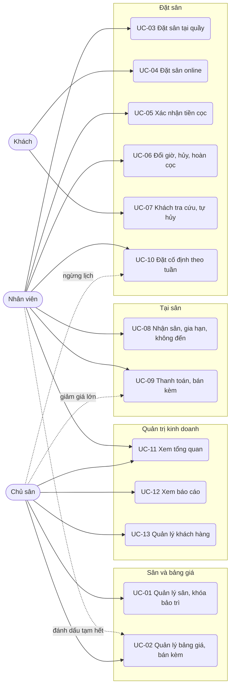
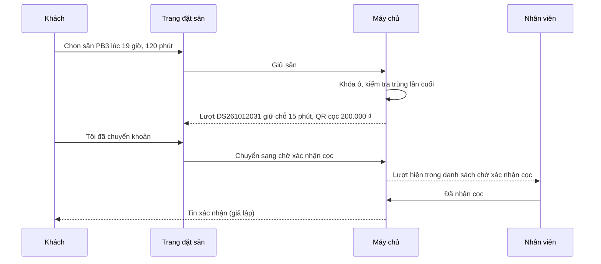

# Đặc tả use case — Cho thuê Sân thể thao

> Use case phần nền (UC-SYS-01 đến UC-SYS-10): `ZDOCS/03-KIEN-TRUC/USE-CASE-NEN.md`.
> Mã FR, BR, SCR tham chiếu `02-SRS.md`.

---

## 1. Tác nhân

| Tác nhân | Mã vai trò | Use case chính |
| :--- | :--- | :--- |
| Khách | — | UC-04, UC-07 |
| Nhân viên | `STAFF` | UC-02 (đánh dấu tạm hết), UC-03, UC-05, UC-06, UC-08, UC-09, UC-10, UC-11 |
| Chủ sân | `MANAGER` | UC-01, UC-02, UC-09 (giảm giá trên 10%), UC-10 (ngừng lịch), UC-11, UC-12, UC-13 |
| Quản trị viên | `ADMIN` | Toàn bộ, cộng phần nền |

---

## 2. Sơ đồ use case

---

## 3. Danh sách use case

| Mã | Tên | Tác nhân chính | Module | Ưu tiên | FR |
| :--- | :--- | :--- | :--- | :---: | :--- |
| UC-01 | Quản lý sân, khóa bảo trì | Chủ sân | Sân và bảng giá | P1 | FR-03, FR-04, FR-08 |
| UC-02 | Quản lý bảng giá, dịch vụ bán kèm | Chủ sân | Sân và bảng giá | P1 | FR-05, FR-06, FR-07 |
| UC-03 | Đặt sân tại quầy | Nhân viên | Đặt sân | P1 | FR-09, FR-10, FR-11, FR-12, FR-33 |
| UC-04 | Đặt sân online | Khách | Đặt sân | P1 | FR-11, FR-15, FR-16, FR-17 |
| UC-05 | Xác nhận tiền cọc | Nhân viên | Đặt sân | P1 | FR-18, FR-20 |
| UC-06 | Đổi giờ, hủy lượt đặt, hoàn cọc | Nhân viên | Đặt sân | P1 | FR-11, FR-13, FR-14, FR-21, FR-22 |
| UC-07 | Khách tra cứu, tự hủy | Khách | Đặt sân | P2 | FR-19 |
| UC-08 | Nhận sân, gia hạn, ghi nhận không đến | Nhân viên | Tại sân | P1 | FR-23, FR-24, FR-25 |
| UC-09 | Thanh toán, bán kèm | Nhân viên | Tại sân | P1 | FR-26, FR-27, FR-28 |
| UC-10 | Đặt cố định theo tuần | Nhân viên | Đặt sân | P2 | FR-29, FR-30, FR-31, FR-32 |
| UC-11 | Xem tổng quan | Chủ sân, Nhân viên | Quản trị kinh doanh | P1 | FR-01, FR-02 |
| UC-12 | Xem báo cáo | Chủ sân | Quản trị kinh doanh | P2 | FR-35, FR-36, FR-37 |
| UC-13 | Quản lý khách hàng | Chủ sân | Quản trị kinh doanh | P3 | FR-34 |

---

## 4. Đặc tả chi tiết

### UC-01: Quản lý sân, khóa bảo trì

| Mục | Nội dung |
| :--- | :--- |
| Tác nhân chính | Chủ sân |
| Mô tả | Khai báo cụm sân, sân, giờ mở cửa; khóa sân để bảo trì |
| Ưu tiên | P1 |
| Điều kiện kích hoạt | Mở thêm sân, đổi giờ hoạt động, thay lưới, sửa đèn, sơn lại mặt sân |
| Tiền điều kiện | Có quyền `courts.create`, `courts.update`; khóa sân cần `courts.block` |
| Hậu điều kiện | Lịch sân và trang đặt online hiện đúng sân, đúng giờ mở cửa, đúng khoảng khóa |
| Yêu cầu liên quan | FR-03, FR-04, FR-08, BR-01, BR-24, BR-25 |
| Màn hình | SCR-11 |

**Luồng chính (thêm sân)**

1. Chủ sân mở Sân; hệ thống hiển thị danh sách theo cụm: mã, tên, loại sân, trong nhà hoặc ngoài trời, trạng thái.
2. Bấm "Thêm sân".
3. Nhập mã, tên, chọn cụm, loại sân, trong nhà hoặc ngoài trời, tải ảnh, nhập mô tả, thứ tự hiển thị.
4. Bấm "Lưu"; sân xuất hiện thành cột trên Lịch sân và trên trang đặt online, giá theo loại sân.

**Luồng thay thế**

- 1a. Cụm sân: tab Cụm sân, thêm hoặc sửa tên, địa chỉ, giờ mở cửa, giờ đóng cửa.
- 1b. Khóa bảo trì: tab Lịch khóa, chọn sân, thời gian từ–đến, lý do; lưu thì vùng khóa hiện gạch chéo trên lưới, không đặt được.
- 1c. Ngừng hoạt động sân: chuyển trạng thái; sân không còn trên lưới và trang đặt online, dữ liệu cũ giữ nguyên.

**Luồng ngoại lệ**

- E1. Mã sân trùng: báo lỗi tại ô mã.
- E2. Khóa bảo trì trùng lượt đang hoạt động: hệ thống liệt kê các lượt (giờ, khách, tiền cọc), không lưu cho tới khi các lượt đó được chuyển sân hoặc hủy với lý do "Sân bảo trì", hoàn 100% cọc (BR-24).
- E3. Ngừng hoạt động sân còn lượt tương lai: từ chối, hiện số lượt còn lại (BR-25).
- E4. Đổi giờ mở cửa làm lượt đã có nằm ngoài giờ: hệ thống liệt kê các lượt bị ảnh hưởng, không lưu.

### UC-02: Quản lý bảng giá, dịch vụ bán kèm

| Mục | Nội dung |
| :--- | :--- |
| Tác nhân chính | Chủ sân |
| Tác nhân phụ | Nhân viên (đánh dấu tạm hết) |
| Mô tả | Khai báo khung giá, đơn giá theo loại sân, ngày lễ, ưu đãi đặt cố định, dịch vụ bán kèm |
| Ưu tiên | P1 |
| Điều kiện kích hoạt | Đổi giá giờ cao điểm, sắp tới ngày lễ, nhập thêm mặt hàng |
| Tiền điều kiện | Có quyền `price-rules.update`; bán kèm cần `add-ons.create` hoặc `add-ons.update` |
| Hậu điều kiện | Lượt đặt mới tính theo giá mới; lượt đã tạo giữ giá cũ (BR-04) |
| Yêu cầu liên quan | FR-05, FR-06, FR-07, BR-03, BR-04, BR-20, BR-25 |
| Màn hình | SCR-12 |

**Luồng chính (sửa bảng giá)**

1. Chủ sân mở Bảng giá, tab Giá sân; hệ thống hiển thị bảng: hàng là loại sân, cột là khung giá của ngày thường và cuối tuần.
2. Chủ sân sửa đơn giá ở một ô, hoặc bấm "Sửa khung" để đổi giờ từ–đến của các khung.
3. Bấm "Lưu"; hệ thống kiểm tra BR-03 và lưu.
4. Hệ thống hiện ví dụ tính tiền một lượt 90 phút qua hai khung để chủ sân kiểm tra lại.

**Luồng thay thế**

- 1a. Ngày lễ, ngày nghỉ: tab Ngày lễ và ngày nghỉ, thêm ngày, chọn loại (áp giá cuối tuần hoặc cụm nghỉ), chọn cụm.
- 1b. Ưu đãi đặt cố định: sửa tỉ lệ (mặc định 10%), áp cho lịch cố định tạo sau đó.
- 1c. Dịch vụ bán kèm: tab Dịch vụ bán kèm, thêm hoặc sửa tên, nhóm, đơn vị, giá; ngừng bán mặt hàng.
- 1d. Nhân viên đánh dấu tạm hết hoặc bán lại một mặt hàng; mặt hàng tạm hết hiện mờ trong hộp bán kèm.

**Luồng ngoại lệ**

- E1. Khung giờ chồng nhau hoặc chưa phủ kín giờ mở cửa: báo lỗi chỉ rõ khoảng giờ bị chồng hoặc bị hở, không lưu.
- E2. Đơn giá không phải bội số 10.000 ₫: báo lỗi tại ô.
- E3. Thêm ngày cụm nghỉ trùng lượt đã có: hệ thống liệt kê các lượt, không lưu cho tới khi các lượt đó được xử lý.

### UC-03: Đặt sân tại quầy

| Mục | Nội dung |
| :--- | :--- |
| Tác nhân chính | Nhân viên |
| Mô tả | Nhận đặt sân qua điện thoại, tin nhắn hoặc khách tới quầy; chọn ô trống trên lưới, thu cọc |
| Ưu tiên | P1 |
| Điều kiện kích hoạt | Khách gọi điện, nhắn Zalo, tới quầy hỏi sân |
| Tiền điều kiện | Có quyền `bookings.create` |
| Hậu điều kiện | Lượt đặt "Đã xác nhận" (đã cọc hoặc miễn cọc) hoặc "Giữ chỗ" (chờ cọc) có mã theo §5.3 |
| Yêu cầu liên quan | FR-09, FR-10, FR-11, FR-12, FR-33, BR-01, BR-02, BR-04, BR-06, BR-08, BR-18, BR-27 |
| Màn hình | SCR-02, SCR-03 |

**Luồng chính**

1. Nhân viên mở Lịch sân; hệ thống hiển thị lưới hôm nay của cụm mặc định, tự cuộn tới giờ hiện tại.
2. Chọn ngày, loại sân; kéo chọn các ô trống liền nhau trên cột sân khách muốn.
3. Hệ thống mở hộp đặt sân, điền sẵn sân, giờ bắt đầu, thời lượng; hiện tiền sân tách theo khung giá (BR-04) và cọc tối thiểu (BR-06).
4. Nhập số điện thoại khách; hệ thống tìm hồ sơ, hiện số lượt đã đặt, số lần không đến trong 60 ngày. Chưa có thì nhập tên để thêm mới.
5. Chọn "Thu cọc ngay", nhập số tiền cọc (từ mức tối thiểu tới 100% tiền sân), chọn tiền mặt hoặc chuyển khoản.
6. Bấm "Lưu"; hệ thống tạo lượt "Đã xác nhận", ghi tiền cọc, ghi tin xác nhận (giả lập), ô trên lưới đổi màu.

**Luồng thay thế**

- 2a. Bấm "Đặt sân" ở thanh trên, tự chọn sân, ngày, giờ, thời lượng.
- 5a. Khách sẽ chuyển cọc sau: chọn "Giữ chỗ chờ cọc", hệ thống đề xuất hạn cọc theo BR-08; lượt vào "Giữ chỗ", quá hạn tự hủy.
- 5b. Khách đang đứng ở quầy, chơi ngay (giờ bắt đầu trong 60 phút tới): chọn "Miễn cọc"; lượt vào thẳng "Đã xác nhận" (BR-08).
- 5c. Chuyển khoản cọc: hệ thống hiện QR có số tiền cọc, nội dung là mã lượt; nhân viên bấm "Đã nhận tiền".

**Luồng ngoại lệ**

- E1. Trùng lượt khác: hộp báo "Trùng lượt DS… 15:30–17:00", nút Lưu khóa (BR-02).
- E2. Ngoài giờ mở cửa, thời lượng dưới 60 phút hoặc không phải bội số 30 phút, trùng khoảng khóa: báo lý do cụ thể (BR-01).
- E3. Tiền cọc nhỏ hơn mức tối thiểu hoặc lớn hơn tiền sân: báo lỗi tại ô.
- E4. Chọn "Miễn cọc" khi giờ bắt đầu cách hiện tại quá 60 phút: lựa chọn bị khóa, có chú thích (BR-08).
- E5. Khách đang bị chặn đặt online: hộp hiện cảnh báo đỏ kèm số lần không đến; nhân viên vẫn đặt được nhưng phải thu cọc.

### UC-04: Đặt sân online

| Mục | Nội dung |
| :--- | :--- |
| Tác nhân chính | Khách |
| Mô tả | Khách xem sân trống, chọn giờ, giữ chỗ và chuyển khoản cọc |
| Ưu tiên | P1 |
| Điều kiện kích hoạt | Khách bấm link đặt sân trong nhóm Zalo, Facebook |
| Tiền điều kiện | Số điện thoại không bị chặn đặt online (BR-27) |
| Hậu điều kiện | Lượt "Chờ xác nhận cọc" giữ sân; hoặc lượt tự hủy khi hết hạn giữ chỗ |
| Yêu cầu liên quan | FR-11, FR-15, FR-16, FR-17, BR-01 đến BR-07, BR-27, NFR-02, NFR-03, NFR-04 |
| Màn hình | SCR-09 |

**Luồng chính**

1. Khách mở link; hệ thống hiện tên, logo, các cụm sân và loại sân.
2. Khách chọn loại sân, cụm, ngày (trong 14 ngày tới); hệ thống hiện lưới sân × mốc 30 phút, ô trống kèm đơn giá khung.
3. Khách chạm ô bắt đầu, chọn thời lượng (60, 90, 120, 150, 180 phút); hệ thống hiện tiền sân và tiền cọc (BR-04, BR-06).
4. Khách nhập họ tên, số điện thoại, bấm "Giữ sân".
5. Hệ thống kiểm tra lại chỗ trống, tạo lượt "Giữ chỗ", hiện QR chuyển khoản tiền cọc (giả lập) với nội dung là mã lượt, đồng hồ đếm ngược 15 phút.
6. Khách chuyển khoản bằng app ngân hàng, bấm "Tôi đã chuyển khoản".
7. Hệ thống chuyển lượt sang "Chờ xác nhận cọc", hiện mã lượt, link tra cứu và dòng "Sân sẽ xác nhận khi nhận được tiền".

**Luồng thay thế**

- 3a. Lượt đi qua hai khung giá: hệ thống hiện chi tiết từng đoạn, vd "15:30–16:00: 50.000 ₫, 16:00–17:00: 200.000 ₫".
- 6a. Khách không bấm trong 15 phút: lượt tự chuyển "Đã hủy", lý do "Hết hạn giữ chỗ", ô trống lại (BR-07).

**Luồng ngoại lệ**

- E1. Hai người cùng giữ một khung giờ: người sau thấy "Khung giờ vừa có người đặt, vui lòng chọn giờ khác", lưới tải lại (NFR-03).
- E2. Giờ bắt đầu cách hiện tại dưới 60 phút hoặc ngày ngoài 14 ngày tới: ô không chọn được (BR-05).
- E3. Số điện thoại đã có 2 lượt đang giữ chỗ hoặc chờ xác nhận cọc: báo "Bạn đang có 2 lượt chờ cọc, vui lòng hoàn tất trước" (BR-05).
- E4. Số điện thoại bị chặn: báo "Số điện thoại này tạm thời không đặt online được, vui lòng gọi sân" kèm hotline (BR-27).

### UC-05: Xác nhận tiền cọc

| Mục | Nội dung |
| :--- | :--- |
| Tác nhân chính | Nhân viên |
| Mô tả | Đối chiếu tiền cọc khách đã chuyển và xác nhận lượt đặt |
| Ưu tiên | P1 |
| Điều kiện kích hoạt | Có lượt "Chờ xác nhận cọc" mới |
| Tiền điều kiện | Có quyền `bookings.confirm-deposit` |
| Hậu điều kiện | Lượt "Đã xác nhận" với tiền cọc đã thu; hoặc lượt "Đã hủy" khi không nhận được tiền |
| Yêu cầu liên quan | FR-18, FR-20, BR-07, BR-11 |
| Màn hình | SCR-01, SCR-02, SCR-05 |

**Luồng chính**

1. Nhân viên thấy lượt "Chờ xác nhận cọc" trong danh sách việc cần làm ở Tổng quan và ô màu vàng trên lưới; lượt chờ quá 30 phút tô đỏ.
2. Mở lượt; hệ thống hiện mã lượt, khách, sân, giờ, số tiền cọc cần nhận, nội dung chuyển khoản mong đợi.
3. Nhân viên mở app ngân hàng, tìm giao dịch có nội dung là mã lượt và đúng số tiền.
4. Bấm "Đã nhận cọc"; hệ thống chuyển lượt sang "Đã xác nhận", ghi tiền cọc đã thu, phương thức chuyển khoản, ghi tin xác nhận (giả lập).

**Luồng thay thế**

- 3a. Khách chuyển thiếu: nhân viên nhập số tiền thực nhận; đủ mức tối thiểu thì xác nhận, không đủ thì gọi khách chuyển thêm hoặc xử lý như E1.

**Luồng ngoại lệ**

- E1. Không thấy tiền về sau khi gọi khách: bấm "Chưa nhận được", nhập lý do; lượt chuyển "Đã hủy", không phát sinh hoàn cọc, ô trống lại.

### UC-06: Đổi giờ, hủy lượt đặt, hoàn cọc

| Mục | Nội dung |
| :--- | :--- |
| Tác nhân chính | Nhân viên |
| Mô tả | Đổi giờ, đổi sân; hủy lượt theo yêu cầu khách hoặc do sân; tính và theo dõi hoàn cọc |
| Ưu tiên | P1 |
| Điều kiện kích hoạt | Khách xin đổi giờ, báo hủy; trời mưa, mất điện, sân cần bảo trì |
| Tiền điều kiện | Có quyền `bookings.update`; hủy cần `bookings.cancel`; đánh dấu đã hoàn cần `bookings.refund` |
| Hậu điều kiện | Lượt ở giờ hoặc sân mới với tiền sân tính lại; hoặc lượt "Đã hủy" kèm khoản hoàn cọc và thu nhập cọc đúng chính sách |
| Yêu cầu liên quan | FR-11, FR-13, FR-14, FR-21, FR-22, BR-02, BR-04, BR-09, BR-11, BR-12 |
| Màn hình | SCR-02, SCR-03, SCR-04, SCR-05 |

**Luồng chính (hủy theo yêu cầu khách)**

1. Nhân viên tìm lượt trên lưới hoặc ở Danh sách lượt đặt theo số điện thoại, mã lượt.
2. Mở lượt, bấm "Hủy lượt", chọn bên hủy "Khách", lý do "Khách báo hủy".
3. Hệ thống tính khoảng cách tới giờ bắt đầu và số tiền hoàn theo BR-09, hiện rõ "Hoàn 50.000 ₫, giữ lại 50.000 ₫ (hủy trước 9 giờ)".
4. Nhân viên xác nhận; hệ thống chuyển lượt sang "Đã hủy", tạo khoản hoàn cọc "Chờ hoàn" (nếu có), ghi phần giữ lại thành thu nhập cọc, ô trống lại.
5. Nhân viên chuyển khoản trả khách bằng app ngân hàng, mở khoản hoàn, bấm "Đã hoàn", nhập mã giao dịch.

**Luồng thay thế**

- 2a. Sân hủy (Thời tiết, Mất điện, Sân bảo trì): chọn bên hủy "Sân"; hệ thống hoàn 100% bất kể thời điểm (BR-09).
- 1a. Đổi giờ, đổi sân: kéo ô sang giờ hoặc sân khác (hoặc sửa trong hộp), chọn bên yêu cầu (Khách, Sân); hệ thống kiểm tra BR-12, tính lại tiền sân, hiện chênh lệch và số tiền dự kiến còn phải thu, nhân viên xác nhận.
- 5a. Khoản hoàn chưa chuyển: nằm trong danh sách "Hoàn cọc chờ chuyển" ở Tổng quan tới khi được đánh dấu.

**Luồng ngoại lệ**

- E1. Khách yêu cầu đổi khi còn dưới 6 giờ tới giờ bắt đầu, hoặc lượt đã đổi theo yêu cầu khách 1 lần: từ chối, nêu lý do (BR-12).
- E2. Giờ hoặc sân mới bị trùng, ngoài giờ mở cửa: ô trở về chỗ cũ, báo lý do (BR-02).
- E3. Hủy lượt "Đang chơi", "Hoàn thành", "Không đến": nút "Hủy lượt" không hiển thị.
- E4. Bấm "Đã hoàn" mà không nhập mã giao dịch: báo lỗi tại ô.

### UC-07: Khách tra cứu, tự hủy

| Mục | Nội dung |
| :--- | :--- |
| Tác nhân chính | Khách |
| Mô tả | Khách xem lại lượt đã đặt, biết trước số tiền được hoàn và tự hủy |
| Ưu tiên | P2 |
| Yêu cầu liên quan | FR-19, BR-09, BR-10, NFR-06 |
| Màn hình | SCR-10 |

**Luồng chính**

1. Khách mở link tra cứu (trong màn đặt thành công hoặc tin nhắn), nhập mã lượt và số điện thoại.
2. Hệ thống hiện sân, ngày, giờ, trạng thái, tiền sân, tiền cọc đã thu, số điện thoại đã che, và dòng "Nếu hủy lúc này, bạn được hoàn … ₫" theo BR-09.
3. Khách bấm "Hủy lượt", xác nhận.
4. Hệ thống chuyển lượt sang "Đã hủy", tạo khoản hoàn cọc "Chờ hoàn" cho nhân viên xử lý, ghi tin hủy (giả lập).
5. Lượt đã tới giờ bắt đầu hoặc đã nhận sân: nút hủy không hiển thị.

### UC-08: Nhận sân, gia hạn, ghi nhận không đến

| Mục | Nội dung |
| :--- | :--- |
| Tác nhân chính | Nhân viên |
| Mô tả | Giao sân khi khách tới, cho chơi thêm giờ, ghi nhận khách không tới |
| Ưu tiên | P1 |
| Điều kiện kích hoạt | Khách tới quầy; khách xin chơi thêm; quá giờ mà khách chưa tới |
| Tiền điều kiện | Có quyền `bookings.update`; lượt "Đã xác nhận" hoặc "Đang chơi" |
| Hậu điều kiện | Lượt "Đang chơi" có giờ nhận sân; hoặc thời lượng và tiền sân tăng thêm; hoặc lượt "Không đến" với cọc thành thu nhập cọc |
| Yêu cầu liên quan | FR-23, FR-24, FR-25, BR-04, BR-13, BR-14, BR-15, BR-27 |
| Màn hình | SCR-02, SCR-05 |

**Luồng chính**

1. Khách tới quầy, báo tên hoặc số điện thoại; nhân viên tìm lượt trên lưới hôm nay.
2. Nhân viên bấm "Nhận sân"; hệ thống ghi giờ nhận sân, chuyển lượt sang "Đang chơi", ô đổi màu xanh lá.
3. Nhân viên đưa khách ra sân, giao vợt, bóng nếu khách thuê (ghi bán kèm ở UC-09).

**Luồng thay thế**

- 3a. Gia hạn: khách xin chơi thêm, nhân viên bấm "Gia hạn", chọn 30, 60 hoặc 90 phút; hệ thống kiểm tra đoạn ngay sau còn trống, hiện tiền thêm theo BR-04, nhân viên xác nhận; giờ kết thúc và tiền sân tăng (BR-15).
- 1a. Khách không tới: quá giờ bắt đầu 15 phút, ô hiện nhãn "Trễ"; nhân viên gọi khách, khách không tới thì bấm "Không đến"; toàn bộ cọc thành thu nhập cọc, phần giờ còn lại trên sân trống để bán cho khách khác (BR-14). Khách có từ 2 lần không đến trong 60 ngày tự bị chặn đặt online (BR-27).
- 1b. 23:59: hệ thống tự chuyển các lượt "Đã xác nhận" chưa nhận sân trong ngày sang "Không đến".

**Luồng ngoại lệ**

- E1. Nhận sân sớm hơn 30 phút trước giờ bắt đầu: nút "Nhận sân" khóa, chú thích "Nhận sân từ hh:mm ngày dd/MM" (BR-13).
- E2. Gia hạn khi đoạn ngay sau đã có lượt hoặc vượt giờ đóng cửa: báo lý do, gợi ý sân khác cùng loại đang trống.
- E3. Chưa quá giờ bắt đầu 15 phút: không có nút "Không đến".

### UC-09: Thanh toán, bán kèm

| Mục | Nội dung |
| :--- | :--- |
| Tác nhân chính | Nhân viên |
| Tác nhân phụ | Chủ sân (giảm giá trên 10%) |
| Mô tả | Ghi bán kèm, giảm giá, trừ cọc, thu phần còn lại, in hóa đơn |
| Ưu tiên | P1 |
| Điều kiện kích hoạt | Khách chơi xong, ra quầy trả vợt và thanh toán |
| Tiền điều kiện | Lượt "Đang chơi"; có quyền `invoices.create` |
| Hậu điều kiện | Hóa đơn có mã theo §5.3; lượt "Hoàn thành" |
| Yêu cầu liên quan | FR-26, FR-27, FR-28, BR-16 đến BR-19, BR-21 |
| Màn hình | SCR-05, SCR-06, SCR-07 |

**Luồng chính**

1. Trong lúc khách chơi, nhân viên mở lượt, bấm "Bán kèm", chọn món (nước, thuê vợt, bóng, áo bib) và số lượng; danh sách bán kèm cập nhật tổng.
2. Khách chơi xong, nhân viên bấm "Thanh toán".
3. Hệ thống mở hộp thanh toán: tiền sân (kể cả phần gia hạn), từng dòng bán kèm, giảm giá, tổng tiền, tiền cọc đã thu, còn phải thu (BR-16).
4. Nhập giảm giá nếu có (BR-17).
5. Chọn phương thức: tiền mặt (nút mệnh giá nhanh hoặc nhập tiền khách đưa, hiện tiền thối) hoặc chuyển khoản (QR giả lập số tiền còn phải thu, bấm "Đã nhận tiền").
6. Bấm "Hoàn tất"; hệ thống tạo hóa đơn, chuyển lượt sang "Hoàn thành", mở bản in.
7. Bản in khổ 80 mm gồm tên sân, mã hóa đơn, mã lượt, sân, giờ chơi, tiền sân tách theo khung, bán kèm, giảm giá, tổng, tiền cọc đã trừ, còn phải thu, phương thức, tiền khách đưa, tiền thối.

**Luồng thay thế**

- 3a. Buổi cuối của lịch cố định: tiền cọc lịch cố định được trừ vào hóa đơn này (BR-21).
- 3b. Tiền cọc lớn hơn tổng tiền: hệ thống hiện "Trả lại khách … ₫" thay cho còn phải thu.
- 4a. Giảm trên 10%: chủ sân đăng nhập (hoặc đổi vai trò) và nhập giảm giá, tối đa 30% tiền sân.

**Luồng ngoại lệ**

- E1. Tiền khách đưa nhỏ hơn còn phải thu: nút "Hoàn tất" khóa, hiện số tiền còn thiếu (BR-18).
- E2. Giảm vượt hạn mức của vai trò: báo "Nhân viên giảm tối đa 10% tiền sân (9.000 ₫)", không áp.
- E3. Mặt hàng tạm hết: hiện mờ, không chọn được (BR-19).
- E4. Mất kết nối khi bấm "Hoàn tất" (chế độ `api`): hộp giữ nguyên, báo thử lại; bấm lại không tạo trùng hóa đơn.

### UC-10: Đặt cố định theo tuần

| Mục | Nội dung |
| :--- | :--- |
| Tác nhân chính | Nhân viên |
| Tác nhân phụ | Chủ sân (ngừng lịch) |
| Mô tả | Giữ sân cố định hằng tuần cho câu lạc bộ, nhóm chơi quen |
| Ưu tiên | P2 |
| Yêu cầu liên quan | FR-29, FR-30, FR-31, FR-32, BR-20 đến BR-23 |
| Màn hình | SCR-08 |

**Luồng chính**

1. Nhân viên mở Đặt cố định, bấm "Tạo lịch cố định".
2. Chọn khách, sân, các thứ trong tuần, giờ bắt đầu, thời lượng, ngày bắt đầu, số tuần.
3. Hệ thống liệt kê từng buổi: ngày, giờ, tiền sân, ưu đãi, tiền sau ưu đãi (BR-20); buổi trùng lượt khác hoặc khoảng khóa được tô đỏ; hiện tổng số buổi và tiền cọc lịch cố định (BR-21).
4. Với mỗi buổi trùng, nhân viên chọn "Bỏ qua" hoặc "Chuyển sân" sang sân cùng loại còn trống (BR-22).
5. Thu cọc lịch cố định, bấm "Lưu"; hệ thống tạo lịch mã `CD…` và các lượt con "Đã xác nhận", ô trên lưới có biểu tượng lặp.
6. Khách báo nghỉ một buổi: nhân viên mở lượt con, bấm "Hủy buổi" (BR-23); chủ sân ngừng cả lịch khi khách thôi chơi.

### UC-11: Xem tổng quan

| Mục | Nội dung |
| :--- | :--- |
| Tác nhân chính | Chủ sân, Nhân viên |
| Mô tả | Nắm tình hình sân hôm nay và các việc cần xử lý ngay |
| Ưu tiên | P1 |
| Tiền điều kiện | Có quyền `dashboard.view` |
| Hậu điều kiện | Không thay đổi dữ liệu |
| Yêu cầu liên quan | FR-01, FR-02, BR-07, BR-28, BR-29 |
| Màn hình | SCR-01 |

**Luồng chính**

1. Chủ sân hoặc nhân viên đăng nhập; hệ thống mở Tổng quan, mặc định tất cả cụm.
2. Hiển thị các thẻ số: số lượt hôm nay theo trạng thái, công suất hôm nay (BR-28), doanh thu ghi nhận hôm nay (BR-29), tổng cọc đang giữ.
3. Hiển thị 3 danh sách việc cần làm: lượt chờ xác nhận cọc (chờ quá 30 phút tô đỏ), lượt bắt đầu trong 60 phút tới chưa nhận sân, khoản hoàn cọc chờ chuyển.
4. Bấm một dòng: mở chi tiết lượt đặt.

**Luồng thay thế**

- 1a. Chọn một cụm: số liệu và danh sách lọc theo cụm.
- 2a. Bấm thẻ công suất: chuyển tới Lịch sân hôm nay.

**Luồng ngoại lệ**

- E1. Hôm nay cụm nghỉ: hiện "Hôm nay cụm sân nghỉ" và danh sách lượt ngày mai.
- E2. Nhân viên không có quyền `reports.view`: Tổng quan không có nút "Xem báo cáo chi tiết"; gõ thẳng `/reports` thì chuyển tới `/forbidden`.

### UC-12: Xem báo cáo

| Mục | Nội dung |
| :--- | :--- |
| Tác nhân chính | Chủ sân |
| Mô tả | Phân tích công suất từng sân, khung giờ, doanh thu, hủy và không đến |
| Ưu tiên | P2 |
| Yêu cầu liên quan | FR-35, FR-36, FR-37, BR-28, BR-29 |
| Màn hình | SCR-13 |

**Luồng chính**

1. Chủ sân mở Báo cáo; mặc định tab Công suất, 30 ngày gần nhất, tất cả cụm.
2. Hệ thống hiển thị công suất từng sân dạng cột, công suất theo khung giá, bảng nhiệt giờ × thứ (ô càng đậm càng kín).
3. Chủ sân đổi khoảng ngày (7 ngày, 30 ngày, Tháng này, Tháng trước, Tùy chọn tối đa 366 ngày), cụm, loại sân.
4. Chuyển tab Doanh thu, Bán kèm, Đặt cố định, Hủy và không đến để xem các báo cáo khác.
